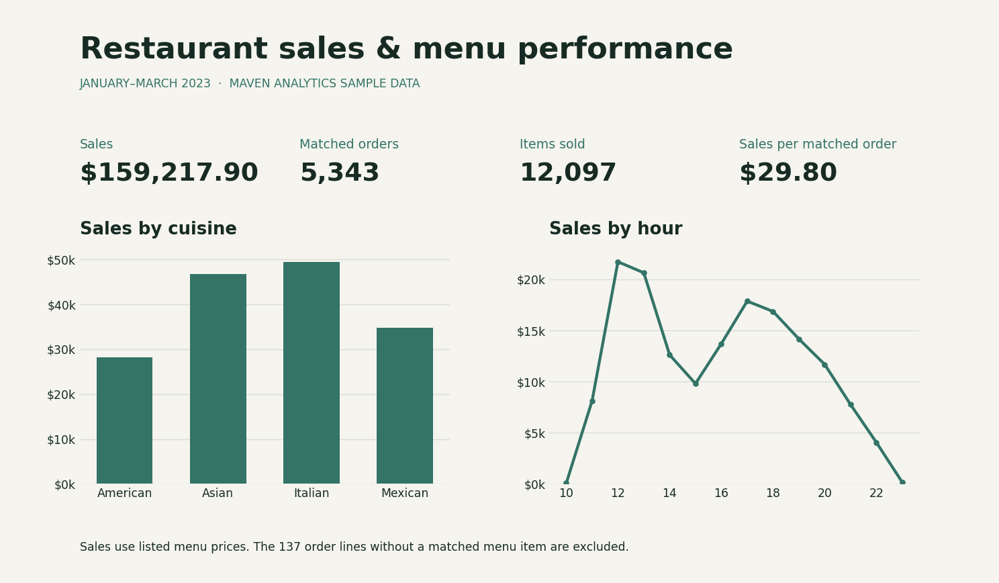

# Restaurant Sales and Menu Performance

A Python analysis of a fictional international-cuisine restaurant from January to March 2023. The project examines what drove sales, when demand peaked, and which items customers ordered together.

**[Open the interactive dashboard](https://oolly99.github.io/restaurant-sales-analysis/)** · [Download the dashboard PDF](docs/restaurant-sales-dashboard.pdf) · [Analysis notebook](notebooks/restaurant_sales_menu_analysis.ipynb) · [Source data](data/raw) · [Optional Power BI rebuild guide](power-bi)

## Findings

| Measure | Result |
| --- | ---: |
| Sales | $159,217.90 |
| Orders with at least one matched menu item | 5,343 |
| Matched items sold | 12,097 |
| Sales per matched order | $29.80 |

- **Italian and Asian dishes generated 60.4% of sales combined.** Italian led in sales ($49,462.70), while Asian led in units sold (3,470).
- **Noon was the highest-sales hour** at $21,718.40 across the quarter. The late-afternoon peak was at 5 p.m. ($17,869.50).
- **Edamame and Hamburger** were the most frequent item pair, appearing in 78 matched orders. Frequency can help shortlist bundle ideas, but it does not establish that a promotion would increase sales.

## Data and methodology

The two [raw CSVs](data/raw) contain 12,234 order lines across 5,370 distinct orders and a 32-item menu. The notebook joins order lines to the menu by item ID. The 137 lines without a match are excluded from the sales analysis. Sales sum listed menu prices, with one item per row. The dataset has no discounts, cost or profit fields. An order can span multiple cuisines, so cuisine-level order counts are not additive. Times use the source clock.

The data is Maven Analytics’ [Restaurant Orders](https://mavenanalytics.io/data-playground/restaurant-orders), listed as GPL 3. The recovered CSVs were verified against the [public mirror](https://github.com/normanew/restaurant-order-analysis) and reproduced the notebook’s saved results.

## Reproduce the analysis

Install `requirements.txt` and run the [notebook](notebooks/restaurant_sales_menu_analysis.ipynb). It reads the raw CSVs and writes [cleaned and summary tables](data/processed). The interactive dashboard uses the same join and measures, with month and cuisine filters that recalculate the distinct order count and basket pairs at each selection.

The deployed dashboard is in [docs](docs). The [dashboard source](dashboard-source) includes the authored layout and reviewed snapshot. Run `python build_dashboard_data.py snapshot.json` to regenerate the reviewed aggregates from the CSVs. The [Power BI guide](power-bi) includes the data types, measures, and visual configuration for rebuilding the native report.
